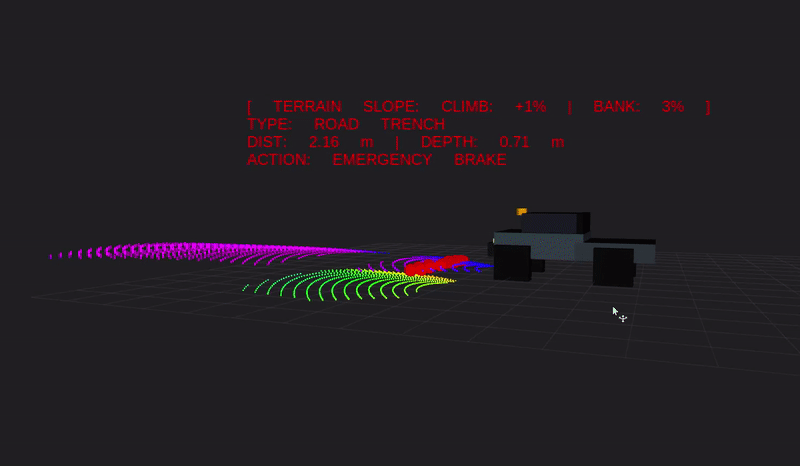
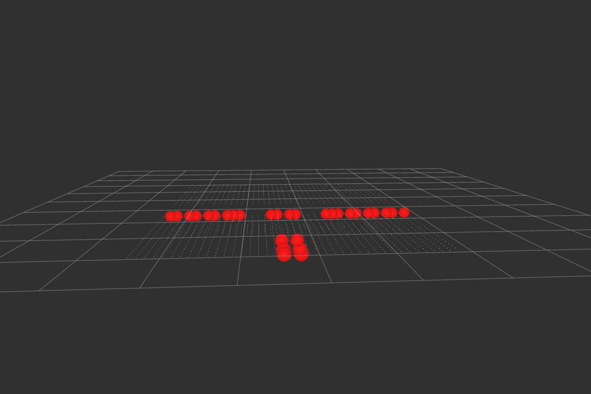
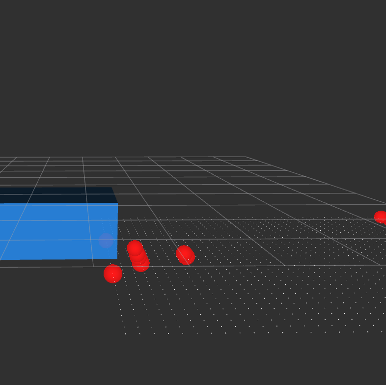
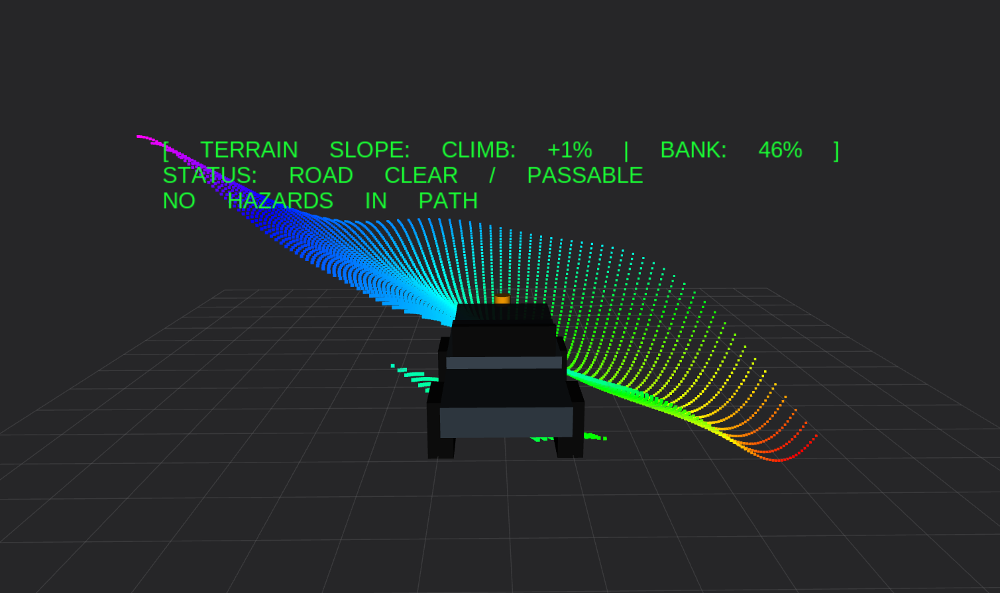
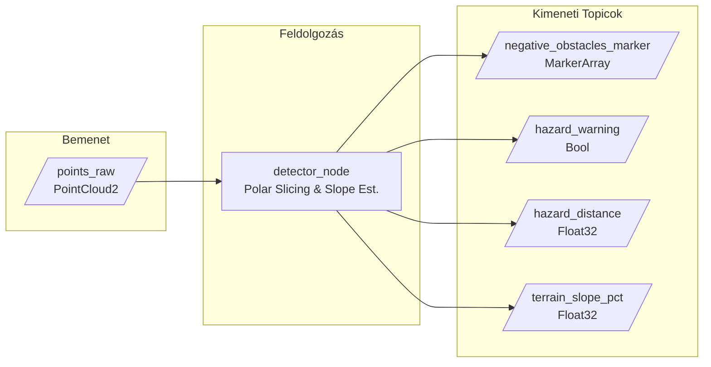

# 3D LiDAR Negative Obstacle & Terrain Slope Detector

[](https://sze-info.github.io/ajr/)
[](https://docs.ros.org/en/humble/)
[](https://isocpp.org/)
[](https://pointclouds.org/)

Valós idejű autonóm terepjáró szoftvercsomag negatív tereptárgyak (árkok, útszakadások, mély kátyúk) detektálására, tereplejtés- és rézsűbecslésre, valamint 3D [RViz](https://wiki.ros.org/rviz) műszerfali megjelenítésre 3D [LiDAR](https://hu.wikipedia.org/wiki/LIDAR) adatok alapján.

* **Készítő:** Kincses Ádám (`ZY2STZ`)
* **Tantárgy:** [Autonóm járművek és robotok programozása (SZE)](https://sze-info.github.io/ajr/)
* **AI Nyilatkozat:** A dokumentáció, a szimulációs környezet és a C++ forráskódok fejlesztése a Google Gemini (LLM) segítségével készült.

---

## Működés közben (Élő Szimuláció)

<p align="center">
  
</p>

---

## Fő Képességek

* **Negatív akadály detektálás:** Sugárirányú poláris szektorokra (Azimuthal Slicing) bontott pontfelhő-feldolgozás, amely kiszűri a természetes hegyoldalakat és csak a hirtelen szinttöréseket azonosítja.
* **Valós idejű lejtés- és rézsűmérés:** Menetirány szerinti hosszirányú emelkedés/lejtés (`CLIMB / DESCENT %`) és keresztirányú oldaldőlés (`BANK %`) számítása.
* **Veszélyosztályozás és manőverjavaslat:**
  * `ROAD TRENCH` / `EXTREME RAVINE` → Automatikus lassítás vagy vészfék (`DECELERATE` / `EMERGENCY BRAKE`).
  * `LANE COLLAPSE` (kátyú, féloldali omlás) → Elkerülő sáv javaslata (`STEER LEFT / RIGHT`).
* **Procedurális 3D szimuláció:** Meredek emelkedőkkel, völgyekkel és változatos akadályokkal felépített off-road pálya 3D pickup járműmodellel.

---

## Fejlesztési Mérföldkövek

| 1. Kezdeti Prototípus | 2. Járműmodell & Akadálykövetés | 3. 3D Pickup, Lejtésszámítás & HUD |
| :---: | :---: | :---: |
|  |  |  |
| Nyers sugárirányú árokperem-detektálás | Egyszerűsített járműtest és dinamikus pontkövetés | Aszimmetrikus terep, 3D HUD és lejtésmérés |

---

## Rendszerarchitektúra és Topic Interfész



### Publikált témakörök járművezérléshez
| Topic | Típus | Funkció |
|---|---|---|
| `/hazard_warning` | `std_msgs/msg/Bool` | Aktív veszélyjelzés (`true` / `false`) |
| `/hazard_distance` | `std_msgs/msg/Float32` | Legközelebbi akadály távolsága méterben |
| `/terrain_slope_pct` | `std_msgs/msg/Float32` | Útfelület aktuális hosszirányú emelkedése/lejtése (%) |
| `/negative_obstacles_marker` | `visualization_msgs/msg/MarkerArray` | Árokperem, jelölőgömbök és a 3D HUD műszerfal |
| `/vehicle_marker` | `visualization_msgs/msg/MarkerArray` | 3D terepjáró járműmodell |

---

## Telepítés és Futtatás

### Fordítás
```bash
cd ~/ros2_ws
colcon build --packages-select negative_obstacle_detector --symlink-install
source install/setup.bash
```

### Indítás
```bash
ros2 launch negative_obstacle_detector demo.launch.py
```

---

## Hivatkozások

* **Tantárgyi tananyag:** [Autonóm járművek és robotok programozása – Széchenyi István Egyetem (SZE)](https://sze-info.github.io/ajr/)
* **Szenzortechnológia:** [LIDAR – Wikipédia](https://hu.wikipedia.org/wiki/LIDAR)
* **Vizualizáció:** [RViz – ROS Wiki](https://wiki.ros.org/rviz)
