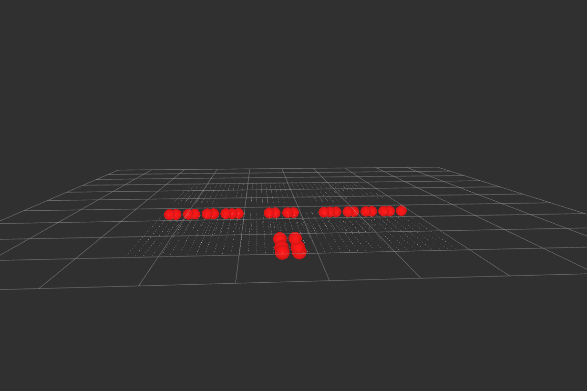

# negative_obstacle_detector csomag

ROS 2 Humble környezetben futó C++ csomag terepi negatív akadályok (árkok, gödrök, hirtelen szintkülönbségek) valós idejű detektálására 3D LiDAR adatok alapján.

## Leírás

Autonóm terepjáróknál a pozitív akadályok (fák, sziklák) mellett a talajszint alatti negatív akadályok jelentik a legnagyobb veszélyt. A csomópont egy beérkező `sensor_msgs/msg/PointCloud2` pontfelhőt dolgoz fel:
* A pontokat sugaras poláris szektorokra bontja a jármű előtt.
* Sugárirányban elemzi a távolság- és magasságváltozásokat.
* Ha a talajszint hirtelen beszakad egy adott küszöbérték alá, vagy kiesnek a várt reflexiók (LiDAR-árnyék / árokba eső sugár), a node detektálja az árok szélét.
* A peremvonalat `visualization_msgs/msg/MarkerArray` formájában jeleníti meg RViz-ben, és vészjelzést publikál.



## Csomópont felépítése és adatfolyam

```mermaid
graph LR
    P1[sensor_height param] --> D[detector_node]
    P2[drop_threshold param] --> D
    P3[radial_gap_threshold param] --> D
    
    PC[/points_raw<br/>sensor_msgs/PointCloud2/] --> D
    
    D --> M[/negative_obstacles_marker<br/>visualization_msgs/MarkerArray/]
    D --> W[/hazard_warning<br/>std_msgs/Bool/]
