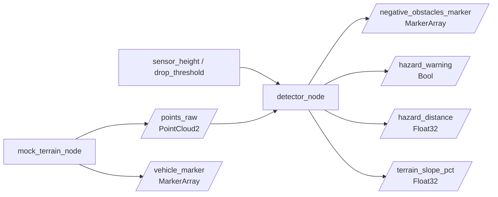

# Negatív Akadály Detektáló és Terepelemző Rendszer

ROS 2 Humble környezetben futó C++ csomag terepi negatív akadályok (árkok, leszakadások, kátyúk) valós idejű detektálására 3D LiDAR pontfelhő alapján, tereplejtés-becsléssel és RViz 3D HUD műszerfallal.

**Készítő:** Kincses Ádám (Neptun: ZY2STZ)  
**Tantárgy:** Autonóm járművek és robotok programozása

---

## Fejlesztési Mérföldkövek és Eredmények

### 1. Végleges Állapot
Aszimmetrikus hullámzó terep, merev 3D terepjáró modell, valós idejű hosszanti lejtés (`CLIMB / DESCENT %`) és rézsűdőlés (`BANK %`) mérés, valamint akadályosztályozó és elkerülő 3D HUD:


---

### 2. Dinamikus Akadálykövetés
Folytonos távolság- és beszakadási mélységmérés mozgó árok esetén:


---

### 3. Kezdeti Prototípus
Poláris szektorokra bontott LiDAR pontfelhő feldolgozása diszkrét árokperem-detektálással:


---

## Adatfolyam és Rendszerarchitektúra



---

## ROS 2 Témakörök (Topics)

| Témakör | Típus | Funkció |
|---|---|---|
| `/points_raw` | `sensor_msgs/msg/PointCloud2` | Bemeneti 3D LiDAR pontfelhő |
| `/negative_obstacles_marker` | `visualization_msgs/msg/MarkerArray` | Piros vészjelző vonal, pontok és a 3D lebegő HUD |
| `/vehicle_marker` | `visualization_msgs/msg/MarkerArray` | 3D terepjáró pickup modell |
| `/hazard_warning` | `std_msgs/msg/Bool` | Riasztási állapot (`true` / `false`) |
| `/hazard_distance` | `std_msgs/msg/Float32` | Akadály távolsága méterben |
| `/terrain_slope_pct` | `std_msgs/msg/Float32` | Útfelület hosszirányú emelkedése/lejtése (%) |

---

## Futtatás

Fordítás a munkaterület gyökerében:
```bash
cd ~/ros2_ws
colcon build --packages-select negative_obstacle_detector --symlink-install
source install/setup.bash
```

Indítás egyetlen paranccsal (automatikusan megnyitja az RViz-t a kész nézettel):
```bash
ros2 launch negative_obstacle_detector demo.launch.py
```
