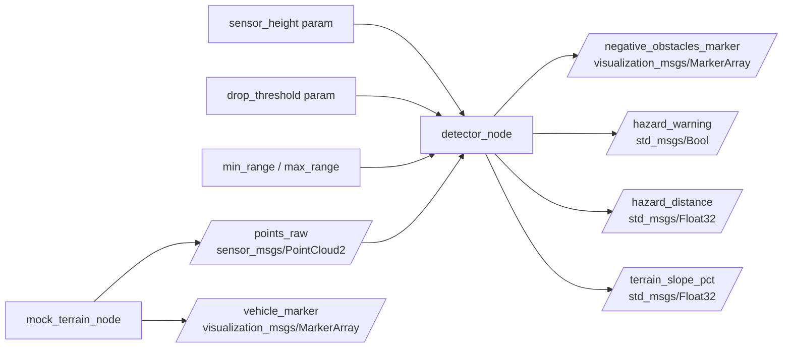

# 3D LiDAR Alapú Negatív Akadály Detektáló és Terepelemző Rendszer

ROS 2 Humble környezetben futó, valós idejű autonóm járműipari szoftvercsomag terepi negatív akadályok (árkok, leszakadások, mély kátyúk) detektálására, tereplejtés- és rézsűbecslésre, valamint 3D HUD vizualizációra.

## Készítő
* **Név:** Kincses Ádám
* **Neptun-kód:** ZY2STZ
* **Tantárgy:** Autonóm járművek és robotok programozása

---

## 1. Projekt Áttekintés és Mérnöki Motiváció

Terepi autonóm mobilitás során a talajszint alatti **negatív akadályok** (árkok, rézsűbeszakadások, kimosott vízmosások) jelentik a legkritikusabb veszélyforrást. Míg a pozitív akadályok (fák, sziklák, épületek) nagy visszaverődési felületet adnak a 3D LiDAR szenzornak, a negatív akadályok esetén:
1. **Kis beesési szög:** Nagyobb távolságban a lézersugarak átsiklanak az árok felett, így a mélyedés sík felületnek tűnhet.
2. **LiDAR árnyékzóna (Occlusion):** Az árok elülső pereme kitakarja a meder fenekét, hirtelen sugárkiesést okozva.
3. **Meredek peremtörés:** A jármű alváza felakadhat, vagy borulás következhet be, ha a rendszer későn észleli a szintkülönbséget.

A csomag célja ezen akadályok korai azonosítása, geometriai osztályozása, a terep pillanatnyi hossz- és keresztirányú lejtésének mérése, valamint automatikus kikerülési javaslat biztosítása.

---

## 2. Fejlesztési Mérföldkövek és Eredmények

### Végleges Állapot (Dinamikus aszimmetrikus terep, 3D Pickup, Lejtésmérő és Osztályozó HUD)
* Erőteljes, szinuszos 3D dombhátak és bal-jobb oldali hegyoldal/rézsű aszimmetria.
* Folyamatosan számolt emelkedő/lejtő () és keresztirányú dőlés ().
* Akadályosztályozás (, , ) és kikerülési manőver javaslat ().
* Merev testként modellezett off-road terepjáró felépítmény tetőre szerelt forgó LiDAR-ral.


### 2. Mérföldkő (Folytonos távolság- és mélységmérés lebegő HUD felirattal)
* Sík terepen mozgó árok dinamikus követése.
* A letörési perem mélységének és az akadály távolságának folytonos számszerűsítése RViz felületen.


### 1. Mérföldkő (Kezdeti funkcionális prototípus)
* Poláris szektorokra bontott nyers pontfelhő feldolgozása diszkrét árokperem-detektálással.


---

## 3. Rendszerarchitektúra és Adatfolyam



---

## 4. Algoritmikai és Matematikai Háttér

### A. Poláris Azimutális Szeletelés
A detektor a derékszögű (, Y, Z$) pontfelhőt poláris szektorokra bontja a jármű orra előtt:
1589\theta = \arctan2(y, x), \quad r_{2D} = \sqrt{x^2 + y^2}1589
A sugaras szektorok száma ( = 64$) biztosítja, hogy a sugarak mentén a pontok egydimenziós távolságsorozatként legyenek rendezhetők:
1589P_{bin} = \{ p_1, p_2, \dots, p_k \}, \quad \text{ahol } r(p_1) < r(p_2) < \dots < r(p_k)1589

### B. Adaptív Gradiens és Peremdetektálás
A természetes lejtő és a veszélyes talajtörés szétválasztásához a node a sugárirányú meredekséget (lokális gradienst) vizsgálja:
1589\Delta z = z_i - z_{i-1}, \quad \Delta r = r_i - r_{i-1}, \quad \text{Slope} = \frac{\Delta z}{\Delta r}1589
* **Természetes lankás domboldal:** $\Delta z < 0$, de $\text{Slope} > -1.2$ (fokozatos ereszkedés).
* **Negatív akadály letörési pereme:** $\Delta z < -h_{küszöb}$ és $\text{Slope} < -1.45$ (hirtelen függőleges beszakadás).

### C. Tereplejtés és Rézsű Becslése
* **Hosszanti Lejtés (Grade %):**
  1589\text{Grade \%} = \frac{\bar{z}_{távoli} - \bar{z}_{közeli}}{\Delta x} \times 100\%1589
* **Oldalirányú Rézsűdőlés (Bank %):**
  1589\text{Bank \%} = \frac{\bar{z}_{bal} - \bar{z}_{jobb}}{\Delta y} \times 100\%1589

---

## 5. Autonóm Döntési Mátrix

A járművezérlő rendszerek számára a csomópont az alábbi döntési állapotokat definiálja:

| Akadály Típusa | Észlelt Távolság ($) | Javasolt Művelet () | HUD Színkód |
|---|---|---|---|
| **Nincs veszély** | - |  | Zöld |
| **Bármelyik árok** |  \ge 4.5\text{ m}$ |  (Fokozatos lassítás) | Sárga |
| **Teljes szélességű árok / Vízmosás** |  < 4.5\text{ m}$ |  (Vészfékezés) | Piros |
| **Jobb sáv beszakadás** |  < 10.0\text{ m}$ |  | Sárga/Piros |
| **Bal sáv beszakadás** |  < 10.0\text{ m}$ |  | Sárga/Piros |

---

## 6. ROS 2 Interfész Specifikáció

### Előfizetett Témakörök (Subscribed Topics)
| Témakör | Üzenettípus | Leírás |
|---|---|---|
|  |  | Bemeneti 3D LiDAR pontfelhő |

### Publikált Témakörök (Published Topics)
| Témakör | Üzenettípus | Frissítés | Leírás |
|---|---|---|---|
|  |  | 15 Hz | Piros peremvonal, jelölőgömbök és a 3D HUD |
|  |  | 15 Hz | 3D merev off-road pickup modell alkatrészei |
|  |  | 15 Hz | Vészriasztás állapota ( ha akadály van) |
|  |  | 15 Hz | Legközelebbi akadály távolsága méterben |
|  |  | 15 Hz | Útfelület aktuális hosszirányú lejtése/emelkedése (%) |

### Konfigurációs Paraméterek ()
| Paraméter | Típus | Alapértelmezett | Leírás |
|---|---|---|---|
|  | double |  | Minimális mélységesés az árokperem detektálásához (m) |
|  | double |  | Szenzor minimális vakfolt-távolsága (m) |
|  | double |  | Szenzor maximális észlelési távolsága (m) |
|  | int |  | Poláris szektorok száma a látómezőben |
|  | double |  | Szimulált haladási sebesség (m/s) |

---

## 7. Fordítás és Futtatás

### Csomag fordítása a munkaterület gyökerében:
```bash
cd ~/ros2_ws
colcon build --packages-select negative_obstacle_detector --symlink-install
source install/setup.bash
```

### Rendszer indítása egyetlen paranccsal:
A launch fájl automatikusan betölti a terepgenerátort, az akadálydetektort és az előre konfigurált RViz környezetet:
```bash
ros2 launch negative_obstacle_detector demo.launch.py
```
