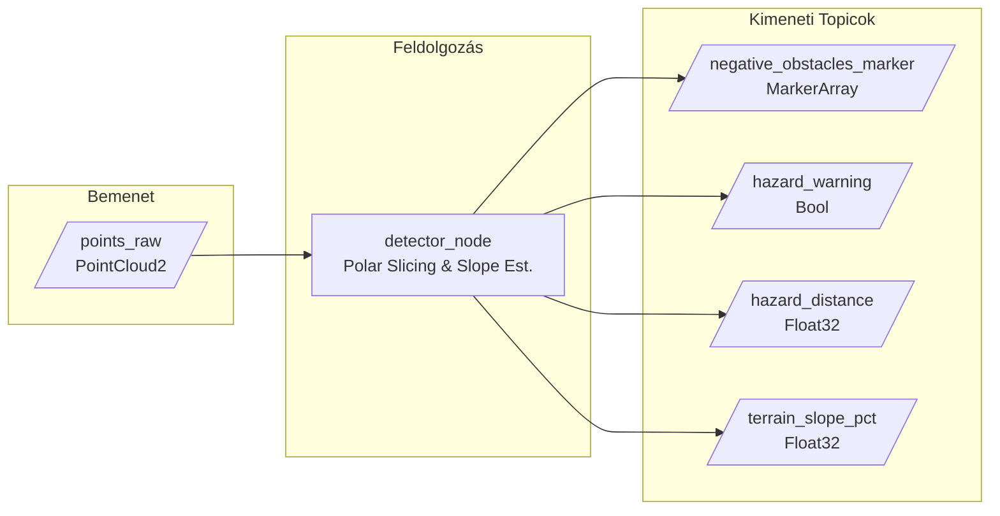

# 3D LiDAR Negative Obstacle & Terrain Slope Detector

[](https://docs.ros.org/en/humble/)
[]()
[](https://pointclouds.org/)

Valós idejű autonóm terepjáró szoftvercsomag negatív tereptárgyak (árkok, útszakadások, mély kátyúk) detektálására, tereplejtés- és rézsűbecslésre, valamint 3D RViz műszerfali megjelenítésre 3D LiDAR adatok alapján.

**Készítő:** Kincses Ádám (Neptun: ZY2STZ)  
**Tantárgy:** Autonóm járművek és robotok programozása  
**Nyilatkozat:** A dokumentáció, a szimulációs környezet és a C++ forráskódok fejlesztése a Google Gemini (LLM) segítségével készült.

---

## Működés közben (Demo)

<p align="center">
  
</p>

---

## Fő Képességek

* **Robusztus negatív akadály detektálás:** Sugárirányú poláris szektorokra (Azimuthal Slicing) bontott pontfelhő-feldolgozás, amely kiszűri a lankás domboldalakat és csak a kritikus szinttöréseket azonosítja.
* **Valós idejű lejtés- és rézsűmérés:** Menetirány szerinti hosszirányú emelkedés/lejtés (`CLIMB / DESCENT %`) és keresztirányú oldaldőlés (`BANK %`) számítása.
* **Veszélyosztályozás és manőverjavaslat:**
  * `ROAD TRENCH` / `EXTREME RAVINE` $
ightarrow$ Automatikus lassítás vagy vészfék (`DECELERATE` / `EMERGENCY BRAKE`).
  * `LANE COLLAPSE` (kátyú, féloldali omlás) $
ightarrow$ Elkerülő sáv javaslata (`STEER LEFT / RIGHT`).
* **Beépített szimuláció:** Procedurális 3D terep változatos akadályokkal és merev testként felépített terepjáró pickup modellel.

---

## Fejlesztési Mérföldkövek

| 1. Kezdeti Prototípus | 2. Akadálykövetés & HUD | 3. Teljes Aszimmetrikus Terep |
| :---: | :---: | :---: |
|  |  |  |
| Diszkrét sugárirányú peremdetektálás | Dinamikus mélység- és távolságmérés | 3D Pickup, lejtésszámítás & döntési logika |

---

## Rendszerarchitektúra és Topic Interfész



### Publikált témakörök járművezérléshez
| Topic | Típus | Funkció |
|---|---|---|
| `/hazard_warning` | `std_msgs/msg/Bool` | Aktív veszélyjelzés (`true` / `false`) |
| `/hazard_distance` | `std_msgs/msg/Float32` | Legközelebbi akadály távolsága méterben |
| `/terrain_slope_pct` | `std_msgs/msg/Float32` | Útfelület aktuális hosszirányú emelkedése/lejtése (%) |
| `/negative_obstacles_marker` | `visualization_msgs/msg/MarkerArray` | Árokperem, jelölőgömbök és a 3D HUD műszerfal |
| `/vehicle_marker` | `visualization_msgs/msg/MarkerArray` | 3D terepjáró járműmodell |

---

## Telepítés és Futtatás

### Fordítás
```bash
cd ~/ros2_ws
colcon build --packages-select negative_obstacle_detector --symlink-install
source install/setup.bash
```

### Indítás
```bash
ros2 launch negative_obstacle_detector demo.launch.py
```

---

## Hivatkozások és Felhasznált Irodalom
1. **ROS 2 Documentation (Humble Hawksbill):** Standard interfaces, Node and Launch system ([docs.ros.org](https://docs.ros.org/en/humble/))
2. **Point Cloud Library (PCL):** Point Cloud conversions, radial geometry analysis ([pointclouds.org](https://pointclouds.org/))
3. **RViz2 Visualization Tutorials:** MarkerArray & PointCloud2 display conventions
